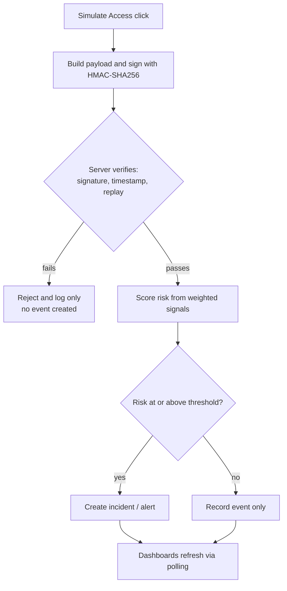
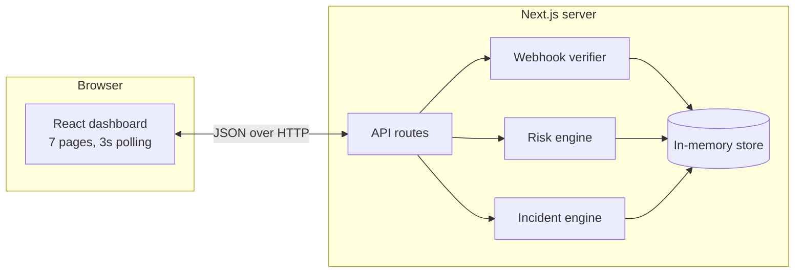

<div align="center">

# 🍯 HoneyShield

### Detect Early. Respond Intelligently. Protect Sensitive Data.

Honeytoken-based threat detection with signed webhooks, explainable risk scoring, and risk-based incident response.

    

**IBM Z Datathon · Challenge: AI Secured: Innovation Without Exposure**

</div>

---

## Table of contents

1. [Overview](#overview)
2. [Key features](#key-features)
3. [How it works](#how-it-works)
4. [Architecture](#architecture)
5. [Tech stack](#tech-stack)
6. [Getting started](#getting-started)
7. [Demo walkthrough](#demo-walkthrough)
8. [Risk scoring](#risk-scoring)
9. [Webhook security](#webhook-security)
10. [API reference](#api-reference)
11. [Project structure](#project-structure)
12. [Real vs simulated](#real-vs-simulated)
13. [Safety and ethics](#safety-and-ethics)
14. [Limitations](#limitations)
15. [Troubleshooting](#troubleshooting)
16. [Roadmap](#roadmap)
17. [Open-source credits](#open-source-credits)
18. [Team](#team)

---

## Overview

**The problem.** Data breaches can stay undetected for months. Traditional IP-based blocking can disrupt legitimate users and still miss quiet, suspicious activity such as stolen-credential use.

**The solution.** HoneyShield plants synthetic decoy files (*honeytokens*) where no legitimate user has a reason to look. Any access is a high-confidence signal. Each access becomes a **signed webhook event** that the server verifies, scores with a **transparent, explainable risk engine**, and turns into an **incident** with a recommended response.

**Why it matters.**
- Earlier detection, because decoys are never touched in normal work.
- Fewer false positives and less user disruption than IP-only blocking.
- Every score comes with the reasons behind it, so analysts can trust and verify it.

---

## Key features

| Area | What it does |
|---|---|
| **Honeytoken Vault** | Five synthetic decoys (`employee_records.xlsx`, `payroll_backup.csv`, `customer_database.json`, `admin_credentials.txt`, `confidential_project.pdf`) with access counts, last-triggered time, and a *Simulate Access* button |
| **Signed webhooks** | HMAC-SHA256 signing, timing-safe verification, timestamp window, duplicate-event (replay) rejection |
| **Risk analysis** | Weighted, deterministic scoring from four signals, with a per-event breakdown and plain-language reasons |
| **Threat events** | Search, filter by severity, type and status, sort by time or risk, and a detail panel with intel context and action history |
| **Webhook inspector** | Generate test events and demonstrate invalid-signature and duplicate-event rejection with the real server logic |
| **Incident response** | Acknowledge, investigate, resolve, simulated rate limit, simulated IP block (with confirmation), timestamped audit trail |
| **Settings** | Adjustable weights, alert threshold, and timestamp window, plus Reset Demo Data |
| **SOC-style UI** | Dark theme, collapsible sidebar, charts, system health panel, notification badge, live refresh every 3 seconds |

---

## How it works



---

## Architecture



All server logic lives in `lib/store.ts`; API routes are thin wrappers that validate input and return JSON.

---

## Tech stack

- **Framework:** Next.js 14 (App Router), React 18, TypeScript
- **Styling:** Tailwind CSS
- **Charts and icons:** Recharts, Lucide React
- **Server:** Node.js API routes, Node `crypto` for HMAC-SHA256
- **Storage:** server-side in-memory store (prototype only)

---

## Getting started

**Requirements:** Node.js 18.17 or newer, npm.

```bash
git clone <your-repo-url> honeyshield   # or unzip honeyshield.zip
cd honeyshield
npm install
npm run dev
```

Open **http://localhost:3000**. The dashboard loads with realistic synthetic data and needs no database or other setup.

### Environment variables

| Variable | Required | Description |
|---|---|---|
| `HONEYSHIELD_SECRET` | No | Webhook signing secret. If unset, a clearly labelled **development-only fallback** is used. Never reuse the fallback outside local demos. |

```bash
cp .env.example .env.local
# then edit HONEYSHIELD_SECRET
```

The secret is read on the server only and is never sent to the browser.

### Scripts

| Command | Purpose |
|---|---|
| `npm run dev` | Start the development server |
| `npm run build` | Create a production build |
| `npm start` | Run the production build |
| `npx tsc --noEmit` | Type-check without building |

---

## Demo walkthrough

1. **Overview**: a populated dashboard with charts, a recent-events table, and system health.
2. **Honeytoken Vault** → click **Simulate Access** on `payroll_backup.csv`. A loading state appears, then a success notification.
3. Click **View event** in the notification. The detail panel shows the risk score, severity, detection reasons, threat-intel context, recommended response, and *Verified* webhook status.
4. **Webhook Inspector** → **Simulate Invalid Signature**. The server rejects it.
5. Click **Generate Test Event**, then **Simulate Duplicate Event**. Replay protection rejects it. Neither test creates a second security event.
6. **Incident Response** → select the new incident → **Acknowledge Alert** → **Simulate Rate Limit**. Review the audit trail.
7. Return to **Overview** to see the updated counts, and open **Risk Analysis** to see the score breakdown.

---

## Risk scoring

> This is a **simulated, deterministic scoring engine, not a trained ML model**. The logic is isolated in `score()` (`lib/store.ts`) so a real model can replace it later.

```
risk = ( Σ weight_i × signal_i ) ÷ ( Σ weight_i ) × 100        clamped to 0–100
```

| Signal | Range | Default weight | Meaning |
|---|---|---|---|
| Honeytoken | 0 or 1 | 45 | A decoy file was accessed |
| Traffic anomaly | 0–1 | 25 | Request rate relative to a 200 requests/min saturation point |
| Threat intelligence | 0–1 | 15 | Source IP matches the **synthetic** demo list |
| Repeated access | 0–1 | 15 | Prior decoy accesses from the same IP within 15 minutes (3 or more saturates) |

**Severity:** 0–29 Low · 30–59 Medium · 60–79 High · 80–100 Critical.
**Alert threshold:** an incident is created when risk is at or above the threshold (default 60, configurable).

**Worked example** (first click on `payroll_backup.csv` after a fresh start): honeytoken 1.0 × 45 = 45, traffic 0.35 × 25 ≈ 8.75, intel 0.8 × 15 = 12, repeat 0 → total ≈ **66, High**. Repeating the access raises the traffic and repeat signals, so the score climbs.

---

## Webhook security

Payload (signed as the exact JSON string):

```json
{
  "eventId": "EVT-1018",
  "tokenId": "TOK-0002",
  "timestamp": 1760000000000,
  "sourceIp": "198.51.100.24",
  "eventType": "Honeytoken Access"
}
```

Verification order on the server:

1. **Signature**: recompute HMAC-SHA256 over the raw payload and compare with `crypto.timingSafeEqual`.
2. **Timestamp**: must fall within the configurable window (default ±300 seconds).
3. **Replay**: event IDs already processed are rejected.

Any failure is logged for display in the Webhook Inspector and creates **no** security event.

---

## API reference

| Method | Endpoint | Purpose |
|---|---|---|
| GET | `/api/state` | Events, tokens, webhook log, config, and dashboard stats |
| GET | `/api/events/:id` | Single event details (404 if not found) |
| POST | `/api/tokens/:id/access` | Simulate honeytoken access end to end |
| POST | `/api/webhook` | Body `{ "action": "generate" \| "verify" \| "invalid" \| "duplicate" }` |
| POST | `/api/incidents/:id` | Body `{ "action": "acknowledge" \| "investigate" \| "resolve" \| "ratelimit" \| "block", "confirm": true }` (`confirm` required for `block`) |
| GET / PUT | `/api/config` | Read or update scoring weights, threshold, and timestamp window |
| POST | `/api/reset` | Restore the initial synthetic data |

Status codes: `200` success, `400` invalid input, `404` not found, `409` invalid state transition, `422` webhook rejected.

---

## Project structure

```
honeyshield/
├── app/
│   ├── layout.tsx
│   ├── globals.css
│   ├── page.tsx                      # Dashboard UI (all seven pages)
│   └── api/
│       ├── state/route.ts
│       ├── reset/route.ts
│       ├── config/route.ts
│       ├── webhook/route.ts
│       ├── events/[id]/route.ts
│       ├── incidents/[id]/route.ts
│       └── tokens/[id]/access/route.ts
├── lib/
│   └── store.ts                      # Store, scoring, webhook verification, incident logic
├── .env.example
├── next.config.js · tailwind.config.ts · postcss.config.js · tsconfig.json
└── package.json
```

---

## Real vs simulated

**Genuinely implemented (server-side)**
- HMAC-SHA256 signing and timing-safe verification
- Timestamp-window validation and duplicate-event rejection
- Weighted risk scoring with configurable weights
- Incident state machine with validation and audit entries
- Shared server state with polling, so all pages stay consistent

**Simulated**
- **Threat intelligence:** a small hardcoded list of reserved documentation IPs, labelled SYNTHETIC. It is not a live feed.
- **Anomaly detection:** deterministic weighted scoring, not machine learning.
- **Rate limiting and IP blocking:** audit-trail entries only. No firewall, network, or real traffic is touched.
- **System health indicators:** describe this local prototype, not external monitoring.

---

## Safety and ethics

- All files, events, and records are **synthetic**. No real personal data or credential files exist.
- Only reserved documentation IP ranges are used (RFC 5737: `192.0.2.0/24`, `198.51.100.0/24`, `203.0.113.0/24`).
- No external scanning, no unauthorized blocking, no real data collection, and no attack simulation against external systems.
- No live feeds, real geolocation, real breach detection, or real ML inference are claimed.

---

## Limitations

- Data lives in server memory and **resets on restart**. This is not a production persistence layer.
- No authentication or role-based access control.
- Alert severity preferences in Settings are interface-only and not persisted.
- Desktop-first design; the mobile layout is basic.
- The in-memory store is per server process, so it is not suitable for multi-instance deployment.

---

## Troubleshooting

| Problem | Fix |
|---|---|
| `npm install` fails | Check your internet connection and that `node -v` is 18.17 or newer |
| Port 3000 is in use | Run `npm run dev -- -p 3001` and open http://localhost:3001 |
| Blank page or build error | Run `npx tsc --noEmit` and fix the reported errors |
| Data disappeared | The server restarted; the store is in-memory and reseeds on start |
| "Simulate Duplicate Event" shows an error | Click **Generate Test Event** first |
| Changed `.env.local` has no effect | Restart `npm run dev` |

---

## Roadmap

- [ ] Integrate a trained anomaly-detection model behind the existing `score()` interface
- [ ] Add a persistent database
- [ ] Connect real threat-intelligence feeds
- [ ] Add authentication and role-based access
- [ ] Automated tests for scoring, signing, and state transitions
- [ ] Exportable incident reports

---

## Open-source credits

| Resource | Use | License |
|---|---|---|
| [Next.js](https://github.com/vercel/next.js) | Framework and API routes | MIT |
| [React](https://github.com/facebook/react) | UI | MIT |
| [Recharts](https://github.com/recharts/recharts) | Charts | MIT |
| [Lucide](https://github.com/lucide-icons/lucide) | Icons | ISC |
| [Tailwind CSS](https://github.com/tailwindlabs/tailwindcss) | Styling | MIT |
| [PostCSS](https://github.com/postcss/postcss) and [Autoprefixer](https://github.com/postcss/autoprefixer) | CSS processing | MIT |
| [TypeScript](https://github.com/microsoft/TypeScript) | Type checking | Apache-2.0 |
| [Node.js crypto](https://nodejs.org/api/crypto.html) | HMAC-SHA256 | Built in |

No external datasets, APIs, or threat feeds are used. Reserved IP ranges follow [RFC 5737](https://www.rfc-editor.org/rfc/rfc5737).

---

## Team

| Name | Role |
|---|---|
| _Your name_ | _Role_ |

Built for the IBM Z Datathon. License: _add your license here (for example MIT)_.
